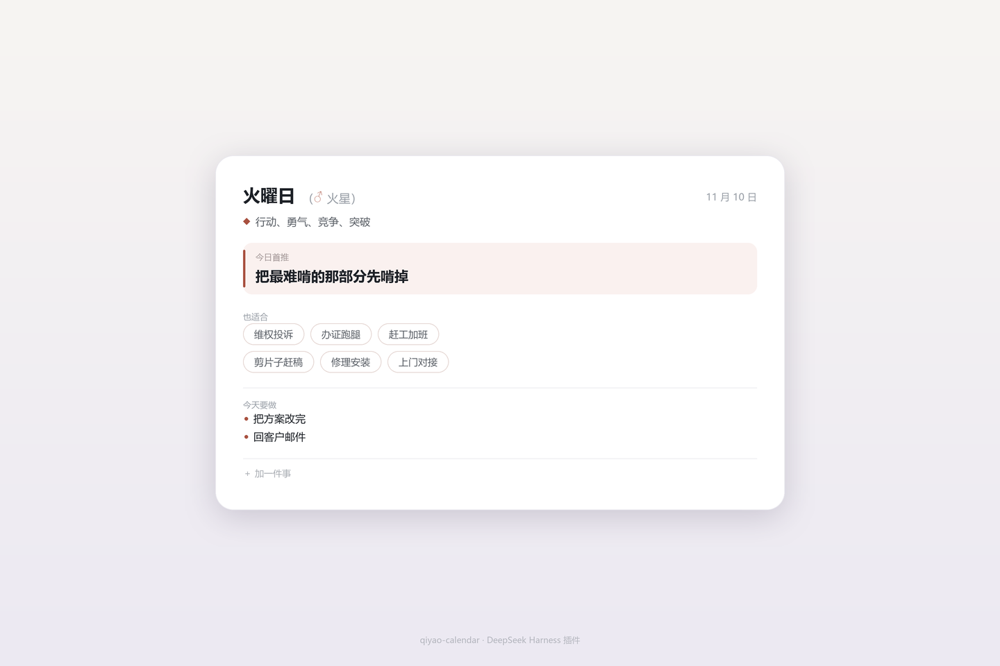

# 七曜日历

> 给每天一个由头，不给每天一个吉凶。

在 DeepSeek Harness 里敲一句 `/qiyao`，或者点一下顶栏那个按钮，它告诉你今天是七曜里的哪一天、这一天的传统象征是什么、可以拿它做点什么。



<sub>MIT · 零依赖 · 不联网 · 不做预测</sub>

## 先说它不做什么

省得误会：

- **不算吉凶。** 不说"今天不宜签约"这种话——七曜在传统历法里本来就不管这个，管吉凶的是六曜、建除、二十八宿值日，那是另一套东西；
- **不联网。** 日期、文案、轮换全在本地算，断网照用；
- **不预测你。** 它只把这一天的传统象征摆出来，今天干什么，你自己判断。

## 装

在 DSH 插件页 → 添加插件 → 填仓库地址：

```
https://github.com/nanrener/dsh-plugin-qiyao
```

也可以直接把仓库文件夹拖进来（本地开发用）。

装完**要重启一次**。命令 /qiyao 是热生效的，但顶部按钮属于客户端插件，客户端插件是启动时打包进页面的。

## 用

```
📅 木曜日（♃ 木星）· 11 月 5 日
✨ 木星：扩张、机遇、增长、学习、远行
✅ 今日首推：把想学的东西开个头，哪怕只看二十分钟
📋 也适合：谈合作、约人喝咖啡、请教前辈、报名课程、出差、订机票
```

查别的日子：`/qiyao 2026-11-10`（也认 `2026/11/10`、`2026年11月10日`）。

### 自己的事

在「文档」文件夹建一个 `七曜事项.txt`，一行一条：

```
交周报
回客户邮件
周三|写方案初稿
周六|归档和备份
```

不带前缀的天天出现；带前缀的只在那一曜出现，没轮到就在「留给周六（土曜日）」里等着。前缀三种写法都认：`周三`、`星期三`、`水曜日`。

文件不存在，这几行就不显示——不想用就当没这功能。

## 几个设计上的取舍

**为什么是七条，不是七十条。**
七曜就是七天一轮，绕不开。所以固定的是骨架（曜日、基调、边界），流动的是内容（首推 8 条、适配 20 条）。

**为什么每个曜日 20 条适配。**
20 和 7 互质，同一个曜日要 20 周才轮完一圈；要是配 14 条，14 能被 7 整除，每周三永远是同一条，看起来就像没轮换。

**为什么顶部按钮的数据是内联的。**
按钮跑在浏览器里，读不到宿主的数据文件，所以 `client.js` 里塞了一份七曜数据的副本。代价是改文案必须跑一次 `node scripts/build-client.mjs`——这条写进「开发」了。

**为什么整张卡只有一个强调色。**
七个曜日各有传统色，但只用在三处：符号、首推块左侧的色条、浅底。文字全部保持中性，否则彩色小字会糊，也会和界面本身的灰调打架。

## 内容从哪来

这个项目的内容分三层，别混为一谈：

**历法史实。** 日曜＝周日、月曜＝周一……土曜＝周六，这一层可查证。七曜记日起源巴比伦的行星时制度，希腊化时期定型，经印度《宿曜经》传入东亚，日本明治九年（1876）把曜日写进星期名，用到现在。英语的 Tuesday、Wednesday、Thursday 是同一套，只是换成了北欧神名。

**行星象征。** 「木星＝扩张、机遇、远行」「土星＝收束、责任、结算」这类对应，来自西方占星的行星象征体系，从托勒密到中世纪阿拉伯占星一脉相承。它内部自洽、传承有序，但它是**象征系统，不是知识**。代码里 `theme` 和 `boundary` 两个字段属于这一层。

**现代转译。** `picks`（首推池）和 `fit`（适配池）是我把象征翻译成当代生活动作的结果，**没有古籍出典**。任何声称"古书说木曜宜投简历"的说法都不可信。

所以别再问"这个准不准"——它本来就不是干那个的。

## 踩过的坑

都是真踩出来的，写给下一个写 DSH 插件的人：

1. **`ctx.command(...)` 不存在。** 官方文档里的命令注册是 `ctx.commands.register({ name, description, input, handler })`，`handler` 返回 `{ kind: 'success', text }`。照着旧写法写，插件加载时报 `cannot get property "command" without inject`。
2. **`package.json` 带 BOM 会直接失败。** PowerShell 的 `Set-Content -Encoding UTF8` 在旧版本会写 BOM，pnpm 报 `Unexpected token '' is not valid JSON`。
3. **浮层被顶栏裁掉。** `position: fixed` 在 `overflow: hidden` 的祖先里一样会被裁，改用原生 `popover` 属性，渲染到最顶层才不受影响。
4. **中文用户目录是隐形炸弹。** 便携版 Git 的证书路径会变成乱码（`C:/Users/������/...`），装包器解压也失败。解法是把工具装到纯英文路径，或改用 SSH over 443。
5. **客户端改动必须重启。** 页面刷新只会重新拉已经打包好的东西，不会重新扫插件目录。

## 开发

```
├─ package.json          # 包身份 + dsh.bundle.patch + dsh.client
├─ cordis.patch.yml      # 把插件条目插入 profile 加载树
├─ index.js              # 宿主侧：/qiyao 命令
├─ data/qiyao.js         # 七曜数据表（文案与逻辑分离）
├─ client.js             # 浏览器侧：顶部按钮（生成物，勿手改）
├─ scripts/
│  ├─ client-body.txt    # 按钮与浮层的源码
│  └─ build-client.mjs   # 把 data 内联进 client.js
└─ docs/preview.png
```

改文案：改 `data/qiyao.js` → `node scripts/build-client.mjs` → 重装插件 → 重启客户端。

改按钮外观：改 `scripts/client-body.txt`，同样跑一次生成脚本。

## 已知限制

- 顶部按钮**不含**你自己加的事项（浏览器端读不到本地文件），完整内容看 `/qiyao`；
- 浮层固定在右上角，窗口极窄时可能贴边；
- 深色模式用 `color-mix` 混色自适应，没有逐项验证过。

## License

MIT，见 [LICENSE](./LICENSE)。
